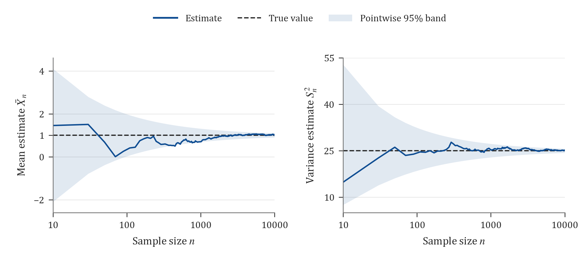
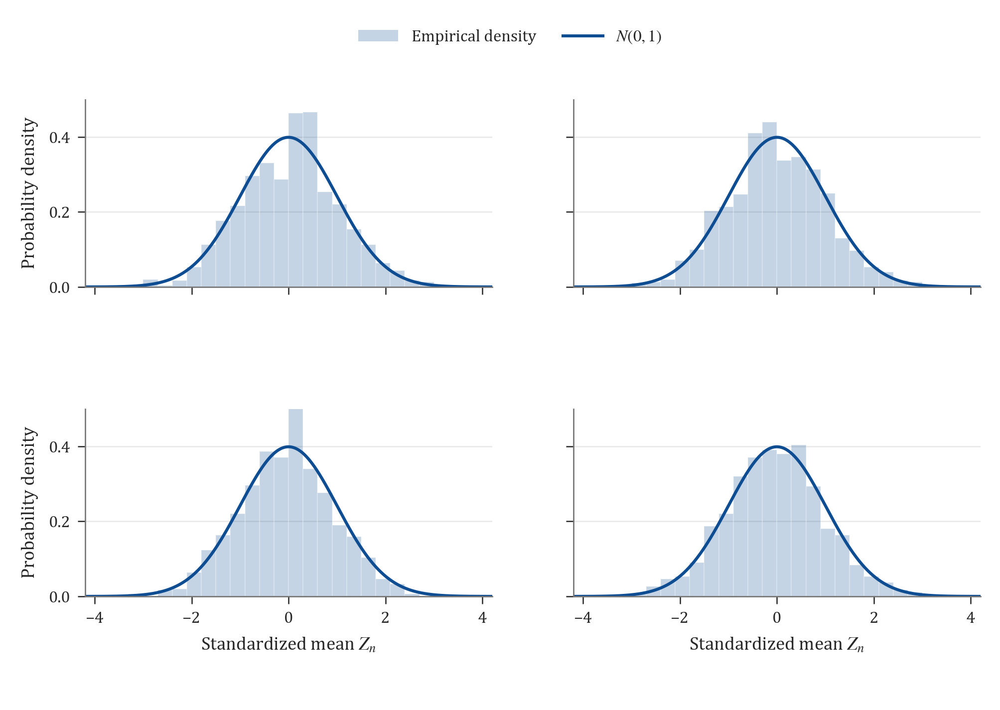
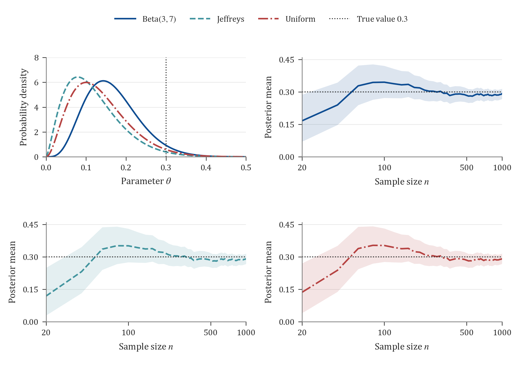
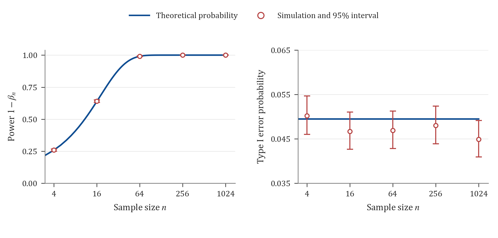
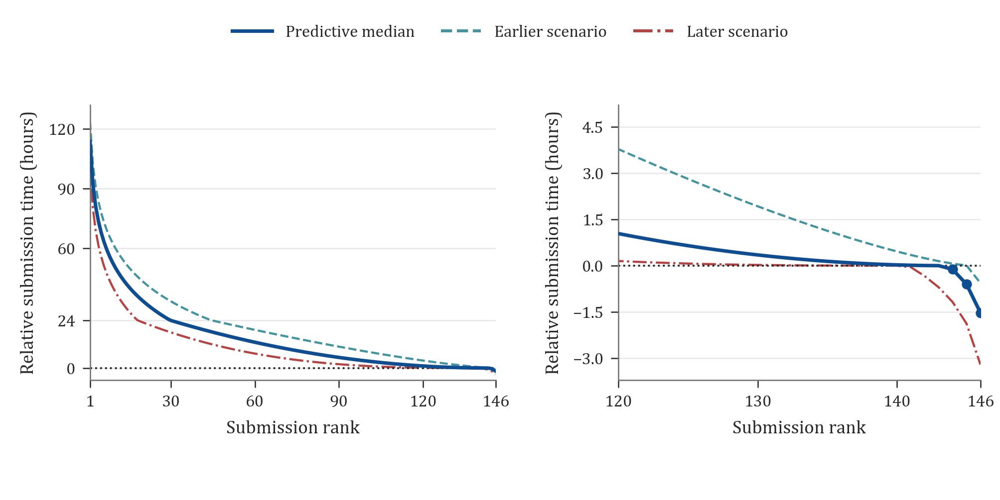

# Mathematical Statistics Final Assignment

The numerical experiments were carried out in R with master seed 20261108. Question 1 uses 1000 replications, and each part of Question 2 uses 10000 replications. Question 3 uses $\theta=1$ and $n=10$, with 10000 replications. Reproducibility materials are described in Appendix B.

## Question 1 Estimation for a normal population

### 1.1 Unbiased estimators and confidence intervals

Let $X_1,\ldots,X_n\overset{\mathrm{iid}}\sim N(\mu,\sigma^2)$. The specified values are $n=100$, $\mu=1$, and $\sigma=5$, so the true variance is $\sigma^2=25$. Unbiased estimators of the mean and variance are

$$
\widehat\mu=\bar X=\frac1n\sum_{i=1}^nX_i,
\qquad
\widehat{\sigma^2}=S^2=\frac1{n-1}\sum_{i=1}^n(X_i-\bar X)^2.
$$

We have $E(\bar X)=\mu$. Also,

$$
E\!\left[\sum_{i=1}^n(X_i-\bar X)^2\right]
=n(\sigma^2+\mu^2)-n\left(\frac{\sigma^2}{n}+\mu^2\right)
=(n-1)\sigma^2,
$$

which gives $E(S^2)=\sigma^2$. The maximum likelihood estimator of the variance is $\widehat{\sigma^2}_{\mathrm{MLE}}=(n-1)S^2/n$, with bias $-\sigma^2/n$.

When both parameters are unknown, the pivotal quantities

$$
\frac{\sqrt n(\bar X-\mu)}{S}\sim t_{n-1},
\qquad
\frac{(n-1)S^2}{\sigma^2}\sim\chi^2_{n-1},
$$

yield the following individual 95% confidence intervals

$$
C_\mu=\left[\bar X-t_{0.975,n-1}\frac S{\sqrt n},\ 
\bar X+t_{0.975,n-1}\frac S{\sqrt n}\right],
$$

$$
C_{\sigma^2}=\left[\frac{(n-1)S^2}{\chi^2_{0.975,n-1}},\ 
\frac{(n-1)S^2}{\chi^2_{0.025,n-1}}\right].
$$

The subscript $p$ denotes the $p$ quantile of the corresponding distribution. For the initial simulated sample, the estimates and confidence intervals are

| Parameter | True value | Unbiased estimate | 95% confidence interval |
|---|---:|---:|---|
| $\mu$ | 1 | 0.574992 | $[-0.516013,\ 1.665997]$ |
| $\sigma^2$ | 25 | 30.232572 | $[23.306170,\ 40.798536]$ |

### 1.2 Mean squared error variance and consistency

**(1) Estimating MSE.** Let $\widehat\theta_1,\ldots,\widehat\theta_B$ be estimates from independent replications, with $B=1000$. The empirical mean squared error is

$$
\widehat{\operatorname{MSE}}=\frac1B\sum_{b=1}^B(\widehat\theta_b-\theta)^2.
$$

Both estimators are unbiased, so their theoretical MSEs equal their variances

$$
\operatorname{MSE}(\bar X)=\operatorname{Var}(\bar X)=\frac{\sigma^2}{n}=0.25,
$$

$$
\operatorname{MSE}(S^2)=\operatorname{Var}(S^2)
=\frac{2\sigma^4}{n-1}=\frac{1250}{99}\approx12.626263.
$$

**(2) Comparison with empirical variance.** Write $\overline{\widehat\theta}=B^{-1}\sum_b\widehat\theta_b$ and define the empirical variance using denominator $B$, so that $\widehat V_B=B^{-1}\sum_b(\widehat\theta_b-\overline{\widehat\theta})^2$. The simulation results are

| Estimator | Simulation mean | Empirical MSE | Empirical variance (denominator $B$) | Theoretical MSE = variance |
|---|---:|---:|---:|---:|
| $\bar X$ | 1.018132 | 0.252950 | 0.252622 | 0.250000 |
| $S^2$ | 25.016761 | 13.028586 | 13.028305 | 12.626263 |

For any finite set of replications, the following identity holds exactly

$$
\widehat{\operatorname{MSE}}=\widehat V_B+
(\overline{\widehat\theta}-\theta)^2.
$$

The empirical MSE exceeds the empirical variance by 0.000329 for $\bar X$ and 0.000281 for $S^2$. These differences equal the squared empirical biases. The Monte Carlo standard errors of the two MSE estimates are approximately 0.011042 and 0.620449, respectively. Each estimate differs from its theoretical value by less than one Monte Carlo standard error.

**(3) Behavior as the sample size increases.** A single normal sequence of length 10000 was generated. Each estimate uses its first $n$ observations, for $n=10,30,\ldots,9990$, with $n=10000$ added to include the endpoint specified in the question. Selected results are

| $n$ | $\bar X_n$ | $S_n^2$ |
|---:|---:|---:|
| 10 | 1.453750 | 14.826310 |
| 110 | 0.409229 | 24.603021 |
| 1010 | 0.696599 | 25.196235 |
| 10000 | 1.005182 | 25.153756 |

The trajectories approach the true parameter values as the sample size increases. For every $\varepsilon>0$, Chebyshev's inequality gives

$$
P(|\bar X_n-\mu|>\varepsilon)\le\frac{\sigma^2}{n\varepsilon^2}\to0,
\qquad
P(|S_n^2-\sigma^2|>\varepsilon)\le\frac{2\sigma^4}{(n-1)\varepsilon^2}\to0.
$$

Thus $\bar X_n$ and $S_n^2$ are consistent estimators of $\mu$ and $\sigma^2$, respectively.

**Figure 1 Consistency of the mean and variance estimators**

(a) Left, sample mean. (b) Right, sample variance.

Dashed lines mark the true values 1 and 25. Shading shows pointwise 95% sampling reference bands. Both trajectories use the same nested sample sequence. The sample size axis is logarithmic.

### 1.3 Sampling distribution of the standardized mean

In the normal model, $\widehat\mu_{\mathrm{MLE}}=\bar X$. The Fisher information about $\mu$ is $I_1(\mu)=1/\sigma^2$ for one observation and $I_n(\mu)=n/\sigma^2$ for the full sample. The information matrix for $(\mu,\sigma^2)$ based on one observation is

$$
\mathcal I_1(\mu,\sigma^2)=
\begin{pmatrix}1/\sigma^2&0\\0&1/(2\sigma^4)\end{pmatrix},
$$

The asymptotic variance of the mean estimator is $\sigma^2/n$. The normal sampling model also gives the exact distributions

$$
\bar X\sim N\!\left(\mu,\frac{\sigma^2}{n}\right),
\qquad
Z_n=\sqrt{nI_1(\mu)}(\bar X-\mu)
=\frac{\sqrt n(\bar X-1)}5\sim N(0,1).
$$

For each of four sample sizes, 1000 replications give the following results for $Z_n$

| $n$ | Empirical mean | Empirical variance (denominator $B$) | Fraction in $[-1.96,1.96]$ |
|---:|---:|---:|---:|
| 10 | 0.034285 | 1.034726 | 0.951 |
| 100 | -0.003026 | 1.012655 | 0.948 |
| 1000 | -0.040769 | 0.913692 | 0.959 |
| 10000 | -0.032302 | 0.992545 | 0.941 |

The results are consistent with $N(0,1)$. With 1000 replications, the standard error of the empirical mean is about 0.0316, and the standard deviation of the empirical variance is about 0.0447. Under normal sampling, $Z_n$ follows the standard normal distribution exactly at every sample size.

Using the sample standard deviation $S$ gives $\sqrt n(\bar X-\mu)/S\sim t_{n-1}$, whose distribution converges to $N(0,1)$ as $n\to\infty$.

**Figure 2 Sampling distribution of the standardized mean**

(a) Upper left, $n=10$. (b) Upper right, $n=100$. (c) Lower left, $n=1000$. (d) Lower right, $n=10000$.

Histograms show empirical densities from 1000 replications per sample size. Curves show the standard normal density. All panels use the same bins and axis limits.

## Question 2 Optimal linear estimation in location and scale families

Throughout this question, a linear estimator has the form $\widehat\theta=\sum_{i=1}^na_iX_i$, with coefficients independent of the unknown parameter.

### 2.1 Location family

**(1) Density.** Let $Z\sim N(0,1)$ and $X=Z+\theta$. Then

$$
f_\theta(x)=f_0(x-\theta)
=\frac1{\sqrt{2\pi}}\exp\!\left[-\frac{(x-\theta)^2}{2}\right],
\quad x\in\mathbb R.
$$

Hence $X\sim N(\theta,1)$, with $E(X)=\theta$ and $\operatorname{Var}(X)=1$. For $\theta=3$, the distribution is $N(3,1)$. The substitution $z=x-\theta$ also verifies that $\int_{\mathbb R}f_\theta(x)\,dx=1$.

**(2) Best linear unbiased estimator.** Unbiasedness requires $\sum_i a_i=1$. By the Cauchy–Schwarz inequality,

$$
\operatorname{MSE}(\widehat\theta)=\operatorname{Var}(\widehat\theta)
=\sum_i a_i^2\ge\frac{(\sum_i a_i)^2}{n}=\frac1n,
$$

with equality if and only if $a_i=1/n$ for every $i$. Therefore, at $n=10$,

$$
\widehat\theta=\bar X,\qquad
\operatorname{MSE}_\theta(\widehat\theta)=\frac{\sigma_Z^2}{n}=0.1.
$$

### 2.2 Scale family

**(1) Density.** Let $Z\sim N(1,1)$ and $X=\theta Z$, where $\theta>0$. A change of variables gives

$$
f_\theta(x)=\frac1\theta f_1\!\left(\frac x\theta\right)
=\frac1{\theta\sqrt{2\pi}}
\exp\!\left[-\frac{(x-\theta)^2}{2\theta^2}\right],
\quad x\in\mathbb R.
$$

Since $dx=\theta\,dz$, this density integrates to one. Thus $X\sim N(\theta,\theta^2)$, with $E(X)=\theta$ and $\operatorname{Var}(X)=\theta^2$. For $\theta=3$, the distribution is $N(3,9)$.

**(2) Linear estimator with minimum MSE.** More generally, write $\mu_Z=E(Z)$ and $\sigma_Z^2=\operatorname{Var}(Z)$. Then

$$
\operatorname{MSE}_\theta\!\left(\sum_i a_iX_i\right)
=\theta^2\left[\sigma_Z^2\sum_i a_i^2+
\left(\mu_Z\sum_i a_i-1\right)^2\right].
$$

Differentiating with respect to each $a_i$ and setting the derivatives to zero gives

$$
\sigma_Z^2a_i+\mu_Z\left(\mu_Z\sum_j a_j-1\right)=0,
\qquad
a_i=\frac{\mu_Z}{n\mu_Z^2+\sigma_Z^2}.
$$

The objective is a strictly convex quadratic function, so this solution is the unique minimizer over the stated class of linear estimators. Substituting $\mu_Z=\sigma_Z^2=1$ and $n=10$ gives

$$
\widehat\theta=\frac1{11}\sum_{i=1}^{10}X_i=\frac{10}{11}\bar X,
\qquad \operatorname{MSE}_\theta(\widehat\theta)
=\frac{\theta^2}{11}=\frac9{11}\approx0.818182.
$$

This estimator has bias $-\theta/(n+1)$, variance $n\theta^2/(n+1)^2$, and MSE $\theta^2/(n+1)$. Shrinking the sample mean by this amount reduces its expected squared error.

Each family was simulated 10000 times. For the scale family, the sample mean was also evaluated on the same samples as a comparator.

| Model and estimator | Initial estimate | Simulation mean | Theoretical MSE | Empirical MSE |
|---|---:|---:|---:|---:|
| Location family $\bar X$ | 2.443051 | 3.003037 | 0.100000 | 0.099841 |
| Scale family $10\bar X/11$ | 2.645826 | 2.721030 | 0.818182 | 0.836689 |
| Scale family $\bar X$ (comparator) | 2.910409 | 2.993133 | 0.900000 | 0.918273 |

The Monte Carlo standard errors of the first two empirical MSEs are approximately 0.001428 and 0.011805. Both estimates are within two standard errors of their theoretical values. In the scale family, the optimal linear estimator reduces empirical MSE by 0.081584 relative to the sample mean, close to the theoretical reduction $0.9-9/11\approx0.081818$.

## Question 3 Rao–Blackwell improvement

### (1) Derivation of the improved estimator

Suppose $X_i\overset{\mathrm{iid}}\sim N(2\theta,1)$. The initial estimator $\widehat\theta=X_1/2$ is unbiased, and $T_n=\sum_iX_i\sim N(2n\theta,n)$ is sufficient for $\theta$.

The pair $(X_1,T_n)$ is jointly normal, with $\operatorname{Cov}(X_1,T_n)=1$. For $n>1$, the conditional distribution is

$$
X_1\mid T_n=t\sim N\!\left(2\theta+\frac1n(t-2n\theta),\ 1-\frac1n\right)
=N\!\left(\frac tn,\frac{n-1}{n}\right).
$$

The Rao–Blackwell estimator is therefore

$$
\widehat\theta^*=E\!\left(\frac{X_1}{2}\mid T_n\right)
=\frac{T_n}{2n}=\frac{\bar X}{2}.
$$

Since $E(\bar X/2)=\theta$, the improved estimator is also unbiased.

### (2) Theoretical and empirical MSE

Unbiasedness gives

$$
\operatorname{MSE}_\theta(X_1/2)=\frac14,
\qquad
\operatorname{MSE}_\theta(\bar X/2)=\frac1{4n}.
$$

The improved MSE is $1/n$ of the original MSE, corresponding to a relative reduction of $1-1/n$. More explicitly, the law of total variance gives

$$
\operatorname{MSE}_\theta(X_1/2)-\operatorname{MSE}_\theta(\bar X/2)
=E\!\left[\operatorname{Var}\!\left(\frac{X_1}{2}\mid T_n\right)\right]
=\frac{n-1}{4n}.
$$

The improvement is strict for $n>1$. For $n=1$, the estimators coincide.

For $\theta=1$, $n=10$, and $B=10000$, both estimators were computed from each simulated $N(2,1)$ sample.

| Estimator | Simulation mean | Theoretical MSE | Empirical MSE |
|---|---:|---:|---:|
| $X_1/2$ | 1.003171 | 0.250000 | 0.250925 |
| $\bar X/2$ | 1.000863 | 0.025000 | 0.024898 |

The empirical MSE ratio is 0.099225, a reduction of about $90.08\%$, consistent with the theoretical reduction of $90\%$. Conditioning on the sufficient statistic removes the remaining conditional variation and reduces risk under squared error loss.

## Question 4 Cramér–Rao bound under reparameterization

Suppose $X_i\overset{\mathrm{iid}}\sim N(\mu,\sigma^2)$, where $\mu$ is known, and the parameter of interest is $\eta=2\sigma$. Set $\theta=\sigma^2$. Then

$$
\eta=\varphi(\theta)=2\sqrt\theta,\qquad
\varphi'(\theta)=\frac1{\sqrt\theta}=\frac1\sigma,
\qquad I_n(\theta)=\frac{n}{2\theta^2}.
$$

For any unbiased estimator $\widehat\eta$ of $\eta$, the Cramér–Rao inequality for a function of the parameter gives

$$
\operatorname{MSE}_\theta(\widehat\eta)
=\operatorname{Var}_\theta(\widehat\eta)
\ge\frac{[\varphi'(\theta)]^2}{I_n(\theta)}
=\frac{2\sigma^2}{n}=\frac{\eta^2}{2n}.
$$

## Question 5 Bayesian estimation under three priors

Let $T_n=\sum_{i=1}^nX_i$. The likelihood for a Bernoulli sample is

$$
L(\theta\mid X)\propto\theta^{T_n}(1-\theta)^{n-T_n}.
$$

### Task 1 Beta prior

**(1) Sample generation.** A sequence of 1000 $\operatorname{Ber}(0.3)$ observations was generated with seed 20261159. Every sample size uses a prefix of this sequence. The initial sample of size $n=20$ is

$$
(0,0,1,0,0,0,1,0,0,0,0,0,0,0,0,0,0,0,0,0),
\qquad T_{20}=2.
$$

**(2) Posterior distribution.** For a general $\operatorname{Beta}(a,b)$ prior, conjugacy gives

$$
\theta\mid X\sim\operatorname{Beta}(a+T_n,b+n-T_n),
\qquad
q(\theta\mid X)=\frac{\theta^{a+T_n-1}(1-\theta)^{b+n-T_n-1}}
{B(a+T_n,b+n-T_n)}.
$$

The Beta(3,7) prior therefore updates to $\operatorname{Beta}(5,25)$ for the initial sample, with posterior mean $5/30=0.166667$.

**(3) Posterior mean and credible interval.** The posterior mean and the 90% equal-tailed credible interval are

$$
\widehat\theta_B=\frac{a+T_n}{n+a+b},\qquad
C_{0.9}(X)=\left[Q_{0.05}(a+T_n,b+n-T_n),\ 
Q_{0.95}(a+T_n,b+n-T_n)\right],
$$

where $Q_p(\alpha,\beta)$ is the $p$ quantile of a Beta distribution with parameters $(\alpha,\beta)$. Posterior means and intervals were computed at all 50 sample sizes $n=20,40,\ldots,1000$.

### Task 2 Prior comparison and Bayesian efficiency

**(4) Jeffreys prior.** For one Bernoulli observation, the score is $(X-\theta)/[\theta(1-\theta)]$. Hence

$$
I_1(\theta)=\frac1{\theta(1-\theta)},\qquad
q_J(\theta)\propto\sqrt{I_1(\theta)}.
$$

Using $\int_0^1[\theta(1-\theta)]^{-1/2}\,d\theta=\pi$ gives

$$
q_J(\theta)=\frac1{\pi\sqrt{\theta(1-\theta)}},\quad0<\theta<1,
\qquad\theta\sim\operatorname{Beta}(1/2,1/2).
$$

The posterior is $\operatorname{Beta}(T_n+1/2,n-T_n+1/2)$. For the same initial sample, this is $\operatorname{Beta}(2.5,18.5)$, with posterior mean $2.5/21=0.119048$.

**(5) Uniform prior.** The prior density $q_F(\theta)=1$ on $(0,1)$ corresponds to $\operatorname{Beta}(1,1)$. Its posterior is $\operatorname{Beta}(T_n+1,n-T_n+1)$, with mean $(T_n+1)/(n+2)$. The initial posterior is $\operatorname{Beta}(3,19)$, with mean $3/22=0.136364$. Credible intervals for all three priors use the equal-tailed quantile formula above.

| $n$ | $T_n$ | Prior | Posterior mean | 90% equal-tailed credible interval |
|---:|---:|---|---:|---|
| 20 | 2 | Beta(3,7) | 0.166667 | [0.070494, 0.288372] |
| 20 | 2 | Jeffreys | 0.119048 | [0.029334, 0.250227] |
| 20 | 2 | Uniform | 0.136364 | [0.040100, 0.270552] |
| 100 | 35 | Beta(3,7) | 0.345455 | [0.272808, 0.421311] |
| 100 | 35 | Jeffreys | 0.351485 | [0.275391, 0.430940] |
| 100 | 35 | Uniform | 0.352941 | [0.277119, 0.432059] |
| 500 | 142 | Beta(3,7) | 0.284314 | [0.251974, 0.317616] |
| 500 | 142 | Jeffreys | 0.284431 | [0.251803, 0.318038] |
| 500 | 142 | Uniform | 0.284861 | [0.252249, 0.318448] |
| 1000 | 292 | Beta(3,7) | 0.292079 | [0.268791, 0.315836] |
| 1000 | 292 | Jeffreys | 0.292208 | [0.268813, 0.316075] |
| 1000 | 292 | Uniform | 0.292415 | [0.269027, 0.316275] |

The posterior mean can be written as

$$
\widehat\theta_B=
\frac n{n+a+b}\frac{T_n}n+
\frac{a+b}{n+a+b}\frac a{a+b}.
$$

The prior means are 0.3, 0.5, and 0.5, and the corresponding strengths $a+b$ are 10, 1, and 2. The initial sample proportion is 0.1. The Beta(3,7) prior exerts the strongest pull toward its mean of 0.3, which equals the simulated true value. As the sample size increases, the prior weights decrease, the posterior means become closer, and the intervals generally narrow. At $n=1000$, the largest difference between posterior means is less than 0.00034.

**Figure 3 Bayesian updating under three priors**

(a) Upper left, posterior densities at $n=20$. (b) Upper right, updating under Beta(3,7). (c) Lower left, updating under Jeffreys prior. (d) Lower right, updating under the uniform prior.

In panels (b)–(d), curves show posterior means, shading shows 90% equal-tailed credible intervals, and dotted lines mark the true value 0.3. All three priors use the same sample sequence. The sample size axis is logarithmic.

**(6) Bayesian MSE and efficiency under the uniform prior.** Let $\delta_B=(T_n+1)/(n+2)$. At a fixed value of $\theta$,

$$
E_\theta(\delta_B)-\theta=\frac{1-2\theta}{n+2},\qquad
\operatorname{Var}_\theta(\delta_B)=\frac{n\theta(1-\theta)}{(n+2)^2}.
$$

Averaging squared error over the joint distribution of the uniform prior and the sample gives the Bayes risk

$$
\begin{aligned}
R_B(\delta_B)
&=\int_0^1\frac{n\theta(1-\theta)+(1-2\theta)^2}{(n+2)^2}\,d\theta\\
&=\frac{n/6+1/3}{(n+2)^2}
=\frac1{6(n+2)}.
\end{aligned}
$$

The sample mean $\delta_0=T_n/n$ has Bayes risk $R_B(\delta_0)=1/(6n)$.

To apply the Bayesian MSE lower bound, set

$$
h(\theta)=\frac{q(\theta)}{I_1(\theta)}=\theta(1-\theta),\quad
J=\int_0^1h(\theta)\,d\theta=\frac16,\quad
H=\int_0^1\frac{[h'(\theta)]^2}{q(\theta)}\,d\theta=\frac13.
$$

Since $h(0)=h(1)=0$, the boundary term in integration by parts vanishes. Both integrals are finite, so the bound gives

$$
R_B(\delta)\ge\frac{J^2}{nJ+H}=\frac1{6(n+2)}.
$$

The posterior mean $\delta_B$ attains this bound and is Bayes efficient under the uniform prior. The equality condition is $h\,\partial_\theta\log L+h\prime=(n+2)(\delta_B-\theta)$. The finite-sample efficiency of the sample mean is $n/(n+2)$, which tends to one as $n$ increases.

## Question 6 Classification and hypothesis testing

### A Misclassification and Type I error

**(1) Classification of a single observation.** The two class densities satisfy

$$
\log\frac{f(x\mid4)}{f(x\mid-4)}
=-\frac{(x-4)^2-(x+4)^2}{2}=8x.
$$

The rule assigns label 1 when $x>0$ and label $-1$ otherwise. The theoretical misclassification probability is the same for both classes

$$
p_e=P_4(X\le0)=P_{-4}(X>0)=\Phi(-4)
\approx3.167124\times10^{-5}.
$$

Each of 1000 replications generated 10000 observations from each class. The aggregated results are

| Distribution | Observations | Errors | Empirical error rate |
|---|---:|---:|---:|
| $N(4,1)$ | 10000000 | 321 | $3.21\times10^{-5}$ |
| $N(-4,1)$ | 10000000 | 355 | $3.55\times10^{-5}$ |
| Pooled | 20000000 | 676 | $3.38\times10^{-5}$ |

The Monte Carlo standard error of the pooled misclassification rate is approximately $1.2584\times10^{-6}$. Its 95% exact binomial interval is $[3.1300,3.6447]\times10^{-5}$, which contains the theoretical probability. For one class in a single replication, the probability of observing no errors is $(1-p_e)^{10000}\approx0.7285$. The probability of no errors in either class is approximately 0.5308, compared with a simulated proportion of 0.517.

**(2) A two-sided test based on a sample.** To test $H_0\colon\mu=4$ against $H_1\colon\mu\ne4$, each test uses 100 observations and the statistic

$$
Z=\frac{\sqrt{100}(\bar X-4)}1=10(\bar X-4).
$$

Under $H_0$, $Z\sim N(0,1)$. Using the critical value specified in the question, reject $H_0$ when $|Z|>1.96$. The theoretical Type I error probability is $2\Phi(-1.96)\approx0.04999579$. Across 10000 independent tests, there were 520 rejections, giving an empirical Type I error rate of 0.0520. The 95% exact binomial interval is [0.047729, 0.056534], consistent with the theoretical value.

### B Consistency of the Neyman–Pearson test

Suppose $X_i\sim N(\theta,1)$ and $\theta_1>\theta_0$. The likelihood ratio is

$$
\frac{L(\theta_1\mid X)}{L(\theta_0\mid X)}
=\exp\!\left[(\theta_1-\theta_0)\sum_iX_i
-\frac n2(\theta_1^2-\theta_0^2)\right],
$$

It is increasing in $\bar X$. Therefore, the level-$\alpha$ Neyman–Pearson test rejects when

$$
\sqrt n(\bar X-\theta_0)>z_{1-\alpha},\qquad
\bar X>\theta_0+\frac{z_{1-\alpha}}{\sqrt n},
$$

where $z_p=\Phi^{-1}(p)$. Under a fixed alternative $\theta_1>\theta_0$, the Type II error probability is

$$
\beta_n=\Phi\!\left(z_{1-\alpha}-\sqrt n(\theta_1-\theta_0)\right)
\longrightarrow0.
$$

Thus the power $1-\beta_n$ tends to one, establishing consistency. With the exact normal quantile as the critical value, the Type I error probability equals $\alpha$ at every sample size.

For the simulation, $\theta_0=0$ and $\theta_1=0.5$ were chosen, with 10000 replications under each hypothesis for every sample size. The specified critical value of 1.65 gives an actual theoretical level of $\Phi(-1.65)\approx0.04947147$.

| $n$ | Empirical Type I error | Theoretical power | Empirical power | Theoretical Type II error |
|---:|---:|---:|---:|---:|
| 4 | 0.0502 | 0.257846 | 0.2593 | 0.742154 |
| 16 | 0.0467 | 0.636831 | 0.6404 | 0.363169 |
| 64 | 0.0469 | 0.990613 | 0.9905 | 0.009387 |
| 256 | 0.0480 | 0.999999999892 | 1.0000 | $1.0766\times10^{-10}$ |
| 1024 | 0.0449 | $\approx1$ | 1.0000 | $5.3269\times10^{-47}$ |

The Monte Carlo standard error of the Type I error rate is about 0.002169. At $n=1024$, the empirical rate is 0.0449, with 95% exact binomial interval [0.040924, 0.049143], slightly below the theoretical level 0.049471. This discrepancy is compatible with finite simulation variability. At the two largest sample sizes, all 10000 tests under the alternative rejected $H_0$. In each case, the 95% exact binomial interval for power is [0.999631, 1]. As $n$ increases, the Type I error rate remains near the specified level while power approaches one.

**Figure 4 Power and Type I error probability**

(a) Left, power under the alternative. (b) Right, Type I error probability under the null.

Blue lines show theoretical probabilities. Red points and error bars show simulated proportions and 95% exact binomial intervals. The settings are $\theta_0=0$, $\theta_1=0.5$, and critical value 1.65, with 10000 replications per setting. The sample size axis is logarithmic.

### C Bayesian hypothesis testing

Suppose $X_i\sim N(2\theta,\sigma^2)$. The hypotheses are $H_0\colon\theta\le2.8$ and $H_1\colon\theta=\theta_1$, and the observed sample mean is $\bar X=4$. We take $\theta_1>2.8$ so that the hypotheses are disjoint.

**Posterior under the normal prior.** Use the suggested continuous prior $\theta\sim N(2.8,b^2)$. With $y=\bar X/2=2$ and $v=\sigma^2/(4n)$, we have $y\mid\theta\sim N(\theta,v)$. The posterior is

$$
\theta\mid X\sim N(m,V),\qquad
V=\left(\frac{4n}{\sigma^2}+\frac1{b^2}\right)^{-1},\qquad
m=V\left(\frac{2n\bar X}{\sigma^2}+\frac{2.8}{b^2}\right).
$$

Writing $\lambda=4nb^2/(\sigma^2+4nb^2)$ gives $m=2.8-0.8\lambda<2.8$. Hence

$$
P(H_0\mid X)=\Phi\!\left(\frac{2.8-m}{\sqrt V}\right)>\frac12.
$$

Under this continuous prior, $P(\theta=\theta_1\mid X)=0$. A Bayesian model comparison involving a point alternative requires a positive prior probability at that point.

**Mixture prior for the point alternative.** Assign model probabilities $P(H_0)=\pi_0$ and $P(H_1)=\pi_1=1-\pi_0$, where $0<\pi_0<1$. Conditional on $H_0$, use the normal prior truncated to $\theta\le2.8$

$$
g_0(\theta)=\frac2b\phi\!\left(\frac{\theta-2.8}{b}\right)
\mathbf1_{\{\theta\le2.8\}},
$$

Conditional on $H_1$, place all mass at $\theta_1$. Let $\varphi(y;a,s^2)$ denote the $N(a,s^2)$ density evaluated at $y$, and write $r_0=\Phi((2.8-m)/\sqrt V)$. The normal product identity gives the two marginal densities of $y$

$$
m_0(y)=2\varphi(y;2.8,b^2+v)r_0,\qquad
m_1(y)=\varphi(y;\theta_1,v).
$$

The Bayes factor and posterior odds are consequently

$$
\mathrm{BF}_{10}=\frac{\varphi(2;\theta_1,v)}
{2\varphi(2;2.8,b^2+v)r_0},\qquad
\frac{P(H_1\mid X)}{P(H_0\mid X)}
=\frac{\pi_1}{\pi_0}\mathrm{BF}_{10}.
$$

Under equal misclassification losses, choose $H_1$ if the posterior odds exceed one and choose $H_0$ otherwise. This rule depends on $n$, $\sigma^2$, $b^2$, $\theta_1$, and the prior model odds $\pi_1/\pi_0$. Their numerical values are unspecified, so the question determines a general decision rule. The posterior probability under the continuous normal prior and the Bayes factor under the mixture prior each refer to their respective prior specification.

## Question 7 Predicting the ordered submission times of all students

There are $N=146$ students. The deadline is 17:25 on November 12, 2026, Beijing time (UTC+8). Define the relative submission time by $X=(T_0-T)/(1\text{ hour})$. Positive values indicate submission before the deadline, and negative values indicate late submission. Predictions are ordered as $\widehat X_1\ge\cdots\ge\widehat X_N$, from earliest to latest submission.

### Available information and model assumptions

The historical excerpt for 2025 contains 37 displayed values and five omissions. The displayed values range from $-2.98$ to 114.02 hours. The previous cohort size and the numbers of omitted observations are unknown. The scenario model below uses the observed time range and the concentration of submissions near the deadline to guide its assumptions.

A single submission scenario is shared by the entire cohort. Conditional on that scenario, students' relative submission times are independent and identically distributed. The component probabilities, distribution parameters, and scenario weights are specified explicitly below.

Each scenario has three components, covering late submissions, submissions in the final 24 hours before the deadline, and submissions more than 24 hours early. Let $\ell_s$ be the late-submission probability and $e_s$ the probability of submission more than one day early. The remaining probability is $1-\ell_s-e_s$. The scenario CDF is

$$
F_s(x)=\begin{cases}
\ell_s e^{x/\tau_{L,s}},&x<0,\\
\ell_s+(1-\ell_s-e_s)(x/24)^{a_s},&0\le x\le24,\\
1-e_s e^{-(x-24)/\tau_{E,s}},&x>24.
\end{cases}
$$

The exponent $0<a_s<1$ produces a higher density near the deadline within the final-day component. The early-submission component has an exponential tail on a daily time scale, allowing lead times greater than 100 hours. The late-submission component uses a shorter exponential time scale. All scale parameters below are in hours.

| Scenario | Weight | Late $\ell$ | Final day | Early $e$ | Shape $a$ | $\tau_L$ | $\tau_E$ |
|---|---:|---:|---:|---:|---:|---:|---:|
| Central | 0.50 | 0.02 | 0.78 | 0.20 | 0.50 | 1.00 | 24 |
| Earlier | 0.25 | 0.01 | 0.69 | 0.30 | 0.75 | 0.75 | 24 |
| Later | 0.25 | 0.04 | 0.84 | 0.12 | 0.35 | 1.50 | 24 |

A separate baseline is defined by a piecewise-linear quantile function $Q_{\mathrm{base}}$. At descending rank $i$, its prediction is $Q_{\mathrm{base}}\{B^{-1}_{N+1-i,i}(0.5)\}$, where $B^{-1}_{a,b}$ is the Beta$(a,b)$ quantile function. Linear interpolation uses probability knots $(0,0.02,0.20,0.35,0.75,0.92,0.98,0.995,1)$ and corresponding times $(-3.5,0,1.47,3.32,20.78,40.95,72.68,114.02,130)$ hours. Several time knots come from the displayed historical values. The probability positions and endpoints are baseline assumptions.

### Prediction under the stated scoring rule

The loss used for grading is

$$
W_1(\widehat X,X)=\frac1N\sum_{i=1}^N|\widehat X_i-X_{[i]}|,
$$

where $X_{[i]}$ is the $i$th largest relative submission time. Expected absolute error is minimized by a median, so the prediction at each rank is the predictive median of the corresponding order statistic.

Conditional on scenario $s$, let $j=N+1-i$. The probability integral transform gives

$$
F_s(X_{[i]})\sim\operatorname{Beta}(j,i).
$$

Let $B_{j,i}$ denote this Beta CDF. Averaging the order-statistic CDFs over the cohort scenarios, the predictive median solves

$$
\sum_s w_s B_{N+1-i,i}\!\left(F_s(\widehat X_i)\right)=\frac12,
\qquad i=1,\ldots,N.
$$

Each $\widehat X_i$ is obtained by numerical root finding. This construction accounts for the finite cohort size and random variation in the numbers of students in each submission component. The order statistics are stochastically ordered across ranks under every scenario, which ensures that their mixture predictive medians form a nonincreasing sequence.

### Model-based comparison and uncertainty

For each scenario, 10000 hypothetical cohorts of 146 students were generated. Three prediction sequences were compared, comprising the quantile baseline, the order-statistic medians under the central scenario, and the scenario-mixture predictive medians. The mean $W_1$ losses within these hypothetical models are shown below in hours.

| Generating scenario | Quantile baseline | Central medians | Mixture medians |
|---|---:|---:|---:|
| Central | 2.1581 | 1.9833 | 1.9833 |
| Earlier | 5.8466 | 6.0477 | 6.0565 |
| Later | 5.2397 | 5.0043 | 4.9950 |
| Weighted average | 3.8506 | 3.7546 | 3.7545 |

The scenario-mixture predictive medians minimize expected $W_1$ under the specified scenarios and weights. Their simulated weighted risk is close to that of the central-scenario predictions, with a difference of approximately $0.000115$ hours. The optimality statement applies to this scenario model and its weights. Actual forecast error can be evaluated once the observed submission sequence becomes available.

The mean absolute distances from the final prediction sequence to the earlier- and later-scenario medians are 5.68 and 4.87 hours, respectively. These values quantify sensitivity to a shift in the cohort's overall submission pattern.

### Predictions

The earliest predicted submission is 113.60 hours before the deadline. The latest is 1.52 hours late. There are 29 predictions above 24 hours, 114 in $[0,24]$ hours, and three below zero. The average of the two middle-ranked predictions is 9.09 hours before the deadline. All 146 values appear in Appendix A.

**Figure 5 Ordered predictions of relative submission times**

(a) Left, predictions for the full cohort. (b) Right, an enlarged view near the deadline.

The blue curve shows the final predictive medians. The teal dashed and red dash-dot curves show the earlier- and later-scenario order-statistic medians. Zero marks the deadline. Positive values indicate early submission and negative values indicate lateness. The cohort contains 146 students.

### Parameter sensitivity

The early-tail scale $\tau_E$ affects the earliest predicted ranks. Holding all other parameters fixed and setting the common $\tau_E$ to 12, 24, or 36 hours gives earliest predictions of 68.80, 113.60, and 158.40 hours before the deadline, respectively. Each alternative shifts the full sequence by a mean absolute amount of approximately 2.30 hours relative to the 24-hour baseline. This parameter stress test shows sensitivity to the assumed tail scale. The baseline scale is 24 hours.

## Appendix A Complete prediction sequence

All values are in hours. Each row covers the rank range shown in the first column. Read the values from left to right, then proceed to the next row. The table contains all 146 predictions. The value 0.00 results from rounding.

| Ranks | 1 | 2 | 3 | 4 | 5 | 6 | 7 | 8 | 9 | 10 |
|---|---:|---:|---:|---:|---:|---:|---:|---:|---:|---:|
| 1–10 | 113.60 | 92.41 | 81.25 | 73.66 | 67.90 | 63.26 | 59.38 | 56.04 | 53.11 | 50.50 |
| 11–20 | 48.15 | 46.01 | 44.04 | 42.23 | 40.54 | 38.96 | 37.48 | 36.09 | 34.77 | 33.52 |
| 21–30 | 32.34 | 31.21 | 30.12 | 29.09 | 28.10 | 27.15 | 26.23 | 25.35 | 24.50 | 23.83 |
| 31–40 | 23.42 | 23.00 | 22.59 | 22.19 | 21.78 | 21.39 | 20.99 | 20.60 | 20.21 | 19.83 |
| 41–50 | 19.45 | 19.07 | 18.70 | 18.33 | 17.96 | 17.60 | 17.24 | 16.89 | 16.54 | 16.19 |
| 51–60 | 15.85 | 15.51 | 15.17 | 14.84 | 14.51 | 14.18 | 13.86 | 13.54 | 13.23 | 12.92 |
| 61–70 | 12.61 | 12.31 | 12.01 | 11.71 | 11.42 | 11.13 | 10.85 | 10.57 | 10.29 | 10.02 |
| 71–80 | 9.75 | 9.48 | 9.22 | 8.96 | 8.71 | 8.45 | 8.21 | 7.96 | 7.72 | 7.48 |
| 81–90 | 7.25 | 7.02 | 6.80 | 6.57 | 6.36 | 6.14 | 5.93 | 5.72 | 5.52 | 5.32 |
| 91–100 | 5.12 | 4.93 | 4.74 | 4.56 | 4.38 | 4.20 | 4.02 | 3.85 | 3.69 | 3.52 |
| 101–110 | 3.37 | 3.21 | 3.06 | 2.91 | 2.76 | 2.62 | 2.49 | 2.35 | 2.22 | 2.10 |
| 111–120 | 1.97 | 1.86 | 1.74 | 1.63 | 1.52 | 1.42 | 1.32 | 1.22 | 1.13 | 1.04 |
| 121–130 | 0.95 | 0.87 | 0.79 | 0.72 | 0.65 | 0.58 | 0.52 | 0.46 | 0.40 | 0.35 |
| 131–140 | 0.30 | 0.25 | 0.21 | 0.17 | 0.14 | 0.11 | 0.08 | 0.06 | 0.04 | 0.03 |
| 141–146 | 0.01 | 0.01 | 0.00 | -0.12 | -0.60 | -1.52 |  |  |  |  |

## Appendix B Code data and reproducibility

The supporting materials comprise the R simulation and calculation scripts, Python verification and plotting scripts, random-seed records, model parameters, and the machine-readable numerical outputs underlying this report. The historical input for Question 7 consists of the 37 values displayed in the question, with the five omissions recorded explicitly.

The master seed is 20261108. The actual seeds and replication counts for individual experiments are recorded in `output/q1-q3/seeds.csv`, `output/q4-q6/seeds.csv`, and `output/q7/seeds.csv`. Independent verification records are stored as `independent_verification.txt` in the corresponding output directories. The English figures are generated by `analysis/plot_figures_en.py`. Point estimates and interval endpoints are generally reported to six decimal places, and the submission predictions are reported to two decimal places.

Repository link to be added after upload.
